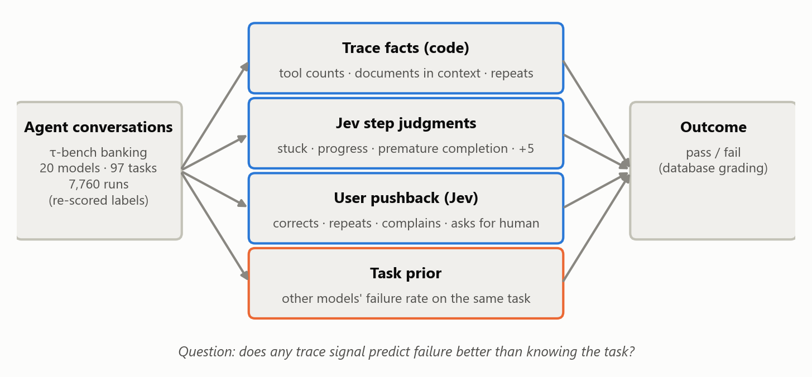
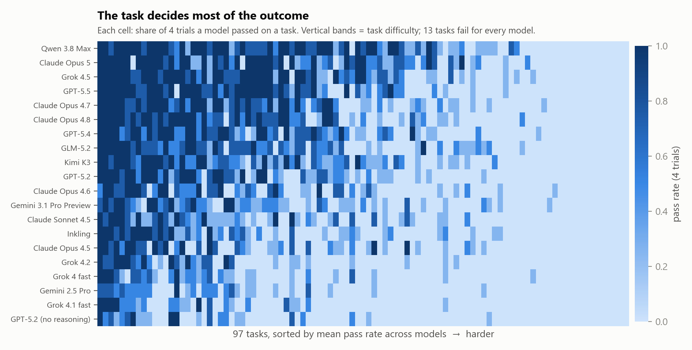
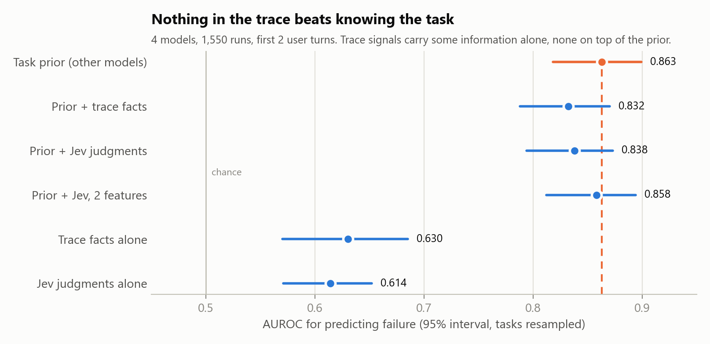
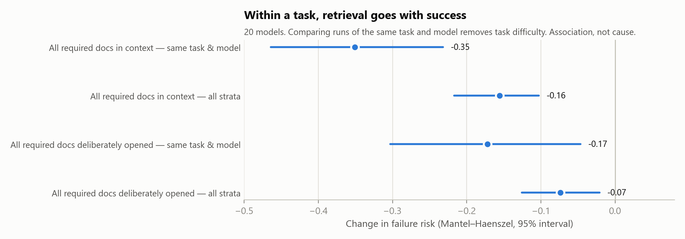
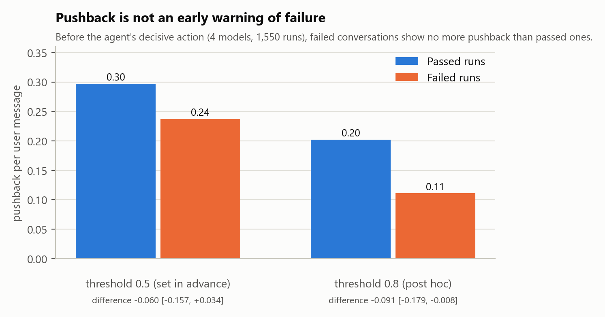

# Agentic Failure Attribution: a study of what agent traces do and don't tell you

**If you know which task an agent faced, you can predict whether it will fail better than with
anything you can read in its trace.**

This repo tests the signals that agent trace-QA tools rely on — counts of tool calls and
retrieval, LLM judgments of each step, and the user's reaction — against real outcomes on
public [τ-bench](https://github.com/sierra-research/tau2-bench) banking-support conversations:
**20 models, 7,760 conversations, 97 tasks**, with labels re-scored by the benchmark's own
grading code. Jev judgments come from [TypeSafe Jev](https://docs.typesafe.ai) (17,160 calls,
$1.50 in total).

<picture>
  <source media="(prefers-color-scheme: dark)" srcset="docs/figures/overview-dark.png">
  
</picture>

## Findings

TL;DR

- Task difficulty predicts failure better than the agent's trace. Adding trace facts or step-level judgments does not improve failure prediction.

- Getting the right documents into context is associated with success. Within the same task, conversations where all required documents reached the agent's context had a lower risk of failure.

- User pushback is a weak early-warning signal. Most failed conversations show no pushback before the agent's decisive action.


### 1. The task comes first

For each model, the strongest predictor of failure is how often the *other* models failed the
same task (leave-model-out, mean over 20 models): **AUROC 0.864** [0.827, 0.892].
Task identity matters far more than model identity: other models' failure rate alone gives
AUROC 0.838 [0.795, 0.867] pooled over all runs, the model's own failure rate gives 0.667
[0.639, 0.697]. 13 of the 97 tasks fail in every run of every model; none passes in every run.

<picture>
  <source media="(prefers-color-scheme: dark)" srcset="docs/figures/task-heatmap-dark.png">
  
</picture>

Nothing from the trace improves on this prior:

| Added to the task prior | First 2 user turns | All turns |
|---|---|---|
| Trace facts (tool counts, documents surfaced / in context / opened, repeats, transfers) — 20 models | −0.022 [−0.036, −0.010] | −0.012 [−0.029, +0.007] |
| Jev's 8 step judgments — 4 models | −0.025 [−0.043, −0.007] | (first 4 turns) −0.025 [−0.045, −0.007] |
| Jev, reduced to 2 features (max of *stuck* and *premature completion*) — 4 models | −0.005 [−0.011, +0.001] | (first 4 turns) −0.007 [−0.013, −0.000] |

On their own, both kinds of trace signal carry some information — Jev judgments AUROC 0.614
[0.571, 0.652], trace facts 0.630 [0.570, 0.685] (first 2 turns, 4 models) — but it is
information the task already gives you. (Brackets: 95% intervals from a bootstrap that
resamples tasks.)

<picture>
  <source media="(prefers-color-scheme: dark)" srcset="docs/figures/auroc-dark.png">
  
</picture>

### 2. Retrieval matters within a task

Raw comparisons mislead: tasks that need many documents are both harder and less often fully
retrieved. Comparing runs **of the same task and model** removes that. In 84 tasks with mixed
outcomes, passing runs had all required documents in context more often in **43** tasks and
less often in **21** (20 ties; exact sign test **p = 0.008**). The Mantel–Haenszel risk
difference in failure, all-in-context minus not, is **−0.351** [−0.464, −0.232] in mixed
model–task strata (−0.156 [−0.217, −0.103] over all strata). The stricter "deliberately
opened" measure points the same way but is weaker (23 vs 14 tasks, p = 0.19).

<picture>
  <source media="(prefers-color-scheme: dark)" srcset="docs/figures/retrieval-dark.png">
  
</picture>

This is an association. Runs that retrieve well may also be runs where the agent understood the
request; only a run with the correct documents supplied would show cause.

### 3. Pushback is not an early warning

Jev checked every natural user message (1,550 conversations, 4 models) for a correction, a
repeated request, a complaint, or a request for a human. The *decisive point* is the agent's
first extra or wrong write action (the end of the run if the expected write never happened).

| No pushback before the decisive point | Passed (719) | Failed (831) |
|---|---|---|
| Threshold 0.5 (set in advance) | 0.548 | **0.568** [0.457, 0.671] |
| Threshold 0.8 (post hoc, chosen on the validation sample) | 0.720 | **0.827** [0.745, 0.896] |

Because the check missed no real pushback in validation (recall 1.00), 57% is a lower bound on
silent failures. Failed runs reach their decisive point sooner, so the table above favours
them looking silent; comparing on equal footing:

- **Pushback per user message before the decisive point** (threshold 0.8): failed **0.111**,
  passed **0.202**; difference −0.091 [−0.179, −0.008]. At 0.5: 0.237 vs 0.297, −0.060
  [−0.157, +0.034].
- **No pushback within the first 1, 2 or 3 user messages**: no difference at either threshold
  (all intervals include 0).
- **Over the whole conversation** (threshold 0.8): 57% of failed and 61% of passed runs show no
  pushback (difference −0.032 [−0.148, +0.090]).

<picture>
  <source media="(prefers-color-scheme: dark)" srcset="docs/figures/pushback-dark.png">
  
</picture>

So pushback does not mark the conversations that are going to fail, and per message it is, if
anything, more common in ones that succeed — consistent with users steering agents back on
track, though this data cannot show that.

## Why it matters

Failure predictors for agents are often evaluated on new agents but *seen tasks*. EarlyEval,
for example, holds out one agent configuration at a time while every agent attempts the full
task pool, and reports no per-task baseline ([arXiv:2609.02783](https://arxiv.org/abs/2609.02783)).
On τ-bench banking, that baseline alone reaches AUROC 0.86, and the trace adds nothing to it.
We do not claim other papers' numbers are inflated — their benchmarks and metrics differ — only
that **a task-prior baseline should be reported** before crediting the trace.

Dissatisfaction-based monitoring (detecting user pushback, then tracing back to a cause, as in
TRACE, [arXiv:2608.09153](https://arxiv.org/abs/2608.09153), evaluated on 75 synthetic traces) is
measured here against outcome labels: on these conversations it flags successful runs at least
as often as failing ones before the mistake happens.

## Data

- **Source:** τ-bench public leaderboard trajectories for the `banking_knowledge` domain
  ([τ-Knowledge, arXiv:2603.04370](https://arxiv.org/abs/2603.04370); 97 tasks, ~700 policy
  documents, an LLM-simulated customer, grading by final database state), downloaded from the
  benchmark's public bucket; standard text submissions with the `gpt-5.2` user simulator.
- **20 models:** Claude Opus 4.5 / 4.6 / 4.7 / 4.8 / 5, Claude Sonnet 4.5, Gemini 2.5 Pro,
  Gemini 3.1 Pro Preview, GLM-5.2, GPT-5.2 (two settings), GPT-5.4, GPT-5.5, Grok 4.1 fast,
  Grok 4.2, Grok 4.5, Grok 4 fast, Inkling, Kimi K3, Qwen 3.8 Max — 388 runs each (97 tasks × 4).
- **Labels re-scored.** Several older trajectory files carried rewards from before tau2-bench
  v1.0.1 fixed banking grading. Every file was re-scored with the v1.0.1 grading code
  (`analysis/rescore.py`); re-scored pass rates match the leaderboard within 0.3 points, and on
  the 8 files that already matched exactly, re-scoring changed no run. The environment is built
  with the BM25 retrieval variant (the official command embeds documents through an API and
  needs a key; grading does not use retrieval), and the one LLM-judged check (task_102) reuses
  the recorded judgment, so re-scoring makes no LLM call.
- **Excluded (6):** four files tau2 v1.0.1 cannot load (Gemini 3 Flash, Gemini 3 Pro, GLM-5,
  Qwen3.5-397B), two still off the leaderboard after re-scoring (Claude Fable 5, −1.0 points;
  GPT-5.6-sol, −4.4); Muse Spark 1.1 has no trajectory file. See `results/data_check.csv`.
- **Robustness:** the pooled results are repeated on the 12 files whose original labels matched
  the leaderboard (`*_B.csv`); they agree.

## Method

- **Trace facts (code, no model):** per run and per first k user turns (k = 2, 4, 6, all) — tool
  counts, search vs write calls, required documents *surfaced* (ID seen), *in context* (body
  entered the context) and *opened* (deliberately read), repeated identical calls, transfers to a
  human, message lengths. Facts at k use only messages up to turn k (tested).
- **Step judgments (Jev 1.14):** JevScope's 8 questions — task alignment, progress, repetition,
  stuck, needs verification, premature completion, unexpected direction, phase — on the first
  6 agent steps; the task given to Jev is the customer's first message (no ground truth).
- **User-message checks (Jev 1.14):** one request per user message with the previous agent and
  user messages; pushback = the highest of *corrects*, *repeats*, *complains*, *asks for a
  human*.
- **Prediction:** logistic regression, fixed C = 1, no tuning. Cross-validation is grouped by
  task (no task in both train and test); when a model's own other trials are added, it is
  leave-one-trial-out. The cross-model prior is the task's pass rate among the other models.
- **Uncertainty:** 95% intervals from 2,000 bootstrap resamples of tasks (seed 0).

### Validation of the pushback check

60 user messages, stratified (30 the check scored ≥ 0.5, 30 below), labelled pushback / not by
a separate LLM that did not see the scores — **model labels, not human labels**.

| Method | Precision | Recall |
|---|---|---|
| Jev, threshold 0.5 | 0.48 | 1.00 |
| Jev, threshold 0.8 (post hoc) | 0.91 | 1.00 |
| Keyword baseline | 0.57 | 0.80 |

Precision on a stratified sample is not the population rate. File: `results/c1_validation.csv`.

## Limits

- **Simulated users.** The customer is an LLM that holds the task script; real customers differ
  ([Lost in Simulation, arXiv:2601.17087](https://arxiv.org/abs/2601.17087)), and the simulator
  cannot know bank policy, so policy mistakes can go unnoticed by design.
- **One domain** (banking support) and one benchmark.
- **Retrieval finding is an association**, not a cause.
- **Validation labels come from a model**, on 60 stratified messages; the 0.8 threshold was
  chosen on that same sample.
- The "opened" document level is loose (any later mention of a document ID counts).
- Prediction uses logistic regression only; a stronger model might extract more from the trace.

## Reproduce

Analysis environment: Python 3.11, `pip install -r requirements.txt`. Data and intermediate
files go to `local/` (not tracked).

```bash
python -m analysis.fetch_tau                      # kept trajectory files -> local/data/tau/
python -m analysis.load local/data/tau/<name>/<file>.json local/work/<name>   # each file, original labels
# re-score each file with tau2-bench v1.0.1 (tag v1.0.1, commit fc0055d) in a separate Python 3.12
# environment, e.g. local/tau2-env with tau2-bench installed editable with the [knowledge] extra:
local/tau2-env/Scripts/python -m analysis.rescore local/data/tau/<name>/<file>.json local/data/tau-rescored/<name>
python -m analysis.data_check                     # label check -> sets A (re-scored) and B (original)
python -m analysis.multi_model --set A            # load, facts, failure flags, pooled analyses
python -m analysis.multi_model --set B            # robustness set
# Jev (needs TYPESAFE_API_KEY in .env; answers are cached by payload hash):
python -m analysis.jev_silent --dry-run           # then --live --max-calls N, then --analyze
python -m analysis.jev_judgments --dry-run        # then --live --max-calls N, then --analyze
python -m analysis.jev_silent --validate          # needs local/work/pushback_handlabel.csv
python -m analysis.c1_window                      # cache only
python -m analysis.figures                        # README figures -> docs/figures/
pytest analysis/tests
```

Jev usage per part (calls, tokens, cost, latency): `results/jev_usage.csv`.

## Repo layout

```
analysis/        loaders, facts, re-scoring, prediction, retrieval and Jev scripts, tests
results/         every table quoted above
docs/            README figures (docs/figures/), upstream JevScope README and screenshots
app/ lib/ ...    upstream JevScope (unchanged)
```

## Credits and license

- Built on [JevScope](https://github.com/KaushikKC/JevScope) — semantic trace observability with Jev (MIT).
  The original JevScope README is in [docs/jevscope-upstream.md](docs/jevscope-upstream.md).
- [τ-bench / tau2-bench](https://github.com/sierra-research/tau2-bench) — benchmark, tasks,
  trajectories and grading code (Sierra, MIT).
- [TypeSafe Jev](https://docs.typesafe.ai) — typed judgments with probabilities.

MIT license (see `LICENSE`).
